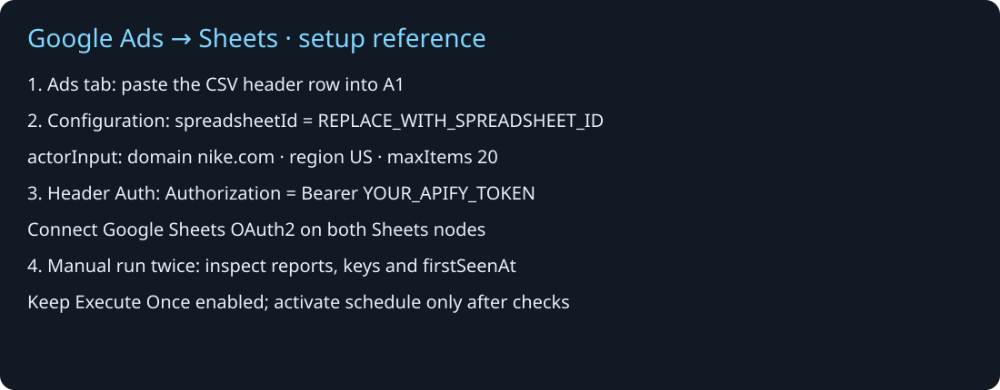

# Google Ads competitor tracking with n8n and Google Sheets

A ready-to-import workflow from DataSmithLab. Collect a bounded snapshot of a competitor's Google ads and keep a deduplicated creative log in your own Google Sheet.

**[View the walkthrough](https://datasmith-lab.github.io/datasmithlab-google-ads-n8n/)** · **[Download the starter ZIP](https://github.com/Datasmith-lab/datasmithlab-google-ads-n8n/releases/latest/download/google-ads-to-sheets-starter.zip)** · **[Google Ads Transparency Scraper on Apify](https://apify.com/datasmithlab/google-ads-transparency-scraper)**

## What it does

1. Read previously saved ad IDs from your dedicated Ads tab.
2. Launch one Apify Actor run, wait for completion and validate HEALTH/TARGETS and dataset counts.
3. Keep previously saved rows, add first-seen IDs and upsert on a scope + advertiser ID + ad ID key.
4. Run manually or enable the daily 09:00 UTC schedule after setup.

The first run creates a baseline. Later first-seen IDs are marked `logged`. First-seen does not establish publication time; limited snapshots may discover older ads later. No Slack account is needed.

## Full tutorial

[Track competitor Google ads in Google Sheets with n8n](https://datasmith-lab.github.io/datasmithlab-google-ads-n8n/track-google-ads-google-sheets-n8n.html) — credentials, first-run checks, scheduling and snapshot limits.

## Requirements

- An Apify account with access to the [Actor](https://apify.com/datasmithlab/google-ads-transparency-scraper).
- n8n with HTTP Request, Code, Wait and Google Sheets nodes. Tested on self-hosted n8n 2.26.4; other versions/cloud require your own setup check.
- A Google account with edit access to your spreadsheet.

## Setup

1. Create a dedicated spreadsheet. Add a tab named **Ads** and paste the exact header row from `ads-sheet-headers.csv` into row 1. Keep other tabs separate.
2. Download `google-ads-to-sheets.n8n.json` and import it in n8n. The workflow is inactive.
3. Open **Configuration (Edit Fields)** and replace `REPLACE_WITH_SPREADSHEET_ID` with your spreadsheet ID. Replace the example `nike.com` domain and `US` region if needed. Start with 20 rows.
4. Create an n8n **Header Auth** credential: name `Authorization`, value `Bearer YOUR_APIFY_TOKEN`. Select it on **Start Actor**, **Get run**, **Get HEALTH**, **Get TARGETS** and **Get ads**. Keep the token in the credential store, never in node text or exported JSON.
5. For a new Google connection, follow the [official OAuth2 setup guide](https://docs.n8n.io/integrations/builtin/credentials/google/oauth-single-service/). n8n Cloud supports managed sign-in; self-hosted instances require custom OAuth setup. Select your **Google Sheets OAuth2** credential on **Read saved ads** and **Save ads**. Refresh columns if your n8n version requires it; keep `key` as the matching column and RAW input mode.
6. Run **Manual start**. Confirm the Actor succeeded, health checks passed and the Ads tab contains baseline rows. An error stops the flow; do not enable Continue On Fail.
7. Run again. Repeated IDs should retain the same key rather than create duplicate rows. Check the summary and your sheet before enabling the schedule.
8. Publish/activate only after your live setup passes. The schedule is **09:00 UTC**; change it to your preferred time. Self-hosted n8n and its computer/server must stay running. Allow one execution at a time; do not overlap manual and scheduled runs.

## First-run checklist

The numbered notes inside the workflow follow the same four stages: prepare, configure, connect, verify. [Open the Actor](https://apify.com/datasmithlab/google-ads-transparency-scraper) before configuring credentials.

*Illustrated reference, not a screenshot of a connected account. Placeholder values only.*

- [ ] Ads tab contains the exact CSV headers; your Sheet remains private.
- [ ] Configuration contains your Sheet ID, one domain and a small 20-row snapshot.
- [ ] All five Apify HTTP nodes use Header Auth; both Sheets nodes use Google OAuth2.
- [ ] Start Actor has Execute Once enabled; workflow is inactive during setup.
- [ ] First manual run succeeds and Run summary is reached; inspect HEALTH/TARGETS and baseline rows.
- [ ] Repeat run updates stable keys without duplicates and preserves firstSeenAt. New unseen IDs may increase the total; first-seen is not publication time.
- [ ] Enable the daily schedule only after the checks pass. Keep one execution at a time.

Your spreadsheet ID is the text between `/d/` and `/edit` in its URL. Set it only in the spreadsheetId field in Configuration (Edit Fields). The $0.10 setting is an Actor run charge cap, not a guarantee of all service costs. OAuth setup time varies; no three-minute setup promise is made.

## Scope and costs

Defaults: one domain (`nike.com`), US, ads mode, copy on, details off, `maxItems=20`, `maxAdsPerTarget=20`, Actor-side `onlyNewAds=false`. The Sheet owns saved-ID history so downstream retries can reread existing records.

This is a **20-ad snapshot, not a complete competitor inventory**. Old rows stay in the sheet; disappearance is not proof an ad ended. Filter changes create a new scope and baseline. Increasing the limit can reveal older unseen IDs. Multiple competitors should use separate workflows/sheets.

The launch request sends `maxTotalChargeUsd=0.10`, 256 MB memory and a 600-second Actor timeout. These defaults are not a guarantee of the total account invoice; n8n hosting and Google/Apify usage terms apply. Check the [current Store pricing](https://apify.com/datasmithlab/google-ads-transparency-scraper) before enabling recurring runs. Polling is limited to 15 minutes; the workflow timeout is 20 minutes.

## Validation

Real local tests on 11 October 2026 verified fresh scraping, live Google Sheets read/upsert and actual schedule-triggered execution. The final test observed 20 ads and retained 34 unique saved keys with zero duplicates; two were first-seen in that run. These are bounded test results, not a coverage or future reliability guarantee. The walkthrough uses synthetic examples and exposes no private spreadsheet or live account data.

## Failure handling

- Failed/aborted/timed-out Actor, missing reports, blocked/skipped targets, enrichment errors, charge caps or dataset count mismatch stop before delivery-state updates.
- If Sheets fails, fix the credential/permissions and retry after the previous execution has ended. The next run rereads the existing sheet. This is not a transaction across all rows.
- **Start Actor uses Execute Once. Keep it enabled.** Otherwise saved rows can each launch a separate run and exhaust the concurrent-run quota.
- 401/403: check your Apify credential and Actor access. 402 concurrent-run errors: inspect current jobs and your plan limit before retrying.
- Missing columns: confirm Ads tab, exact headers and matching key.
- Empty healthy output does not prove the competitor has no advertising. Review filters and TARGETS.
- Do not interpret missing image-rendered copy as a complete extraction failure; fields depend on source availability.

## Security and support

No credentials, private Sheet ID, customer rows or environment files are included. Everyone connects their own accounts. Grant only the spreadsheet access needed for this workflow; never share credential exports. Ad copy is stored using RAW input mode. Use a dedicated sheet and one execution at a time.

For scraper source/access questions, use the [Actor's Issues tab](https://apify.com/datasmithlab/google-ads-transparency-scraper/issues). For this template, open a GitHub issue with a redacted error; do not include tokens or private execution exports.

## Distribution status

This is a DataSmithLab GitHub starter, not an approved listing in n8n's template directory. Slack delivery is outside this package. No third-party endorsement is implied.
